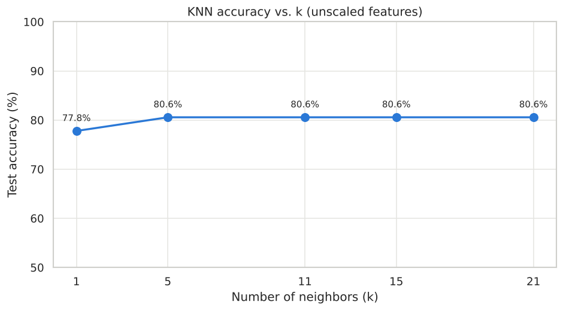
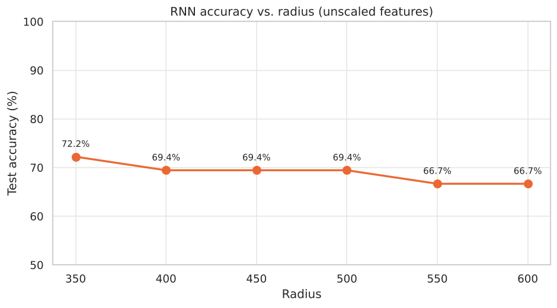

# MSCS 634 – Lab 2: KNN and Radius Neighbors Classification

**Author:** Noel Erkie
**Course:** MSCS 634 – Big Data and Data Mining

## Purpose

This lab compares two distance-based classifiers, **K-Nearest Neighbors (KNN)** and **Radius Neighbors (RNN)**, on
scikit-learn's Wine dataset. The goal is to see how the choice of `k` (KNN) and `radius` (RNN) affects test accuracy,
and when each model is the better choice.

## Dataset

The Wine dataset (`sklearn.datasets.load_wine`) has **178 wines, 13 chemical features, and 3 classes** (cultivars),
with 59 / 71 / 48 samples per class and no missing values. It ships with scikit-learn, so no data file is needed. The
data was split 80/20 (142 training, 36 testing) with stratification and `random_state=42`.

## Results

| k (KNN) | Accuracy |   | Radius (RNN) | Accuracy |
| --- | --- | --- | --- | --- |
| 1 | 77.78% | | 350 | **72.22%** |
| 5 | **80.56%** | | 400 | 69.44% |
| 11 | **80.56%** | | 450 | 69.44% |
| 15 | **80.56%** | | 500 | 69.44% |
| 21 | **80.56%** | | 550 | 66.67% |
| | | | 600 | 66.67% |




## Key Insights

- **KNN outperformed RNN at every setting tested.** Best KNN: 80.6% (k = 5–21). Best RNN: 72.2% (radius = 350).
  Both beat the 40% baseline of always predicting the largest class.
- **KNN:** k = 1 was the weakest (77.8%) because a single neighbor is sensitive to noise. Accuracy stabilized from k = 5
  onward, so KNN was not very sensitive to k in this range.
- **RNN:** accuracy fell as the radius grew. At radius 350 the average test point already had 57% of the training set
  inside its radius, and at 600 it had 78%. Votes become nearly global, so predictions drift toward the majority class.
  The trend suggests a radius below 350 could do better.
- **Feature scaling matters more than either parameter.** `proline` ranges from 278 to 1,680 while most features are
  below 15, so it dominates Euclidean distance. A supplementary test with standardized features raised KNN accuracy from
  about 78–81% to **97–100%**. Changing k or radius moved accuracy by only about 3–6 points.

**When to prefer each model**

- **KNN:** when data density varies, when a meaningful distance threshold is unknown, or as a robust default.
  It always finds k neighbors.
- **RNN:** when features are scaled and density is fairly even, when "similar" has a natural distance cutoff, or when
  you want to flag points that have no close neighbors as outliers instead of forcing a prediction.

## Challenges and Decisions

- **Unscaled features.** The radius values given in the lab (350–600) only make sense on the raw feature scale, so the
  main models were trained without scaling, as the lab specifies. The scale imbalance explained the modest accuracy, so
  I added a clearly labeled supplementary KNN run with `StandardScaler` (fit on training data only, to avoid leakage).
- **Points with no neighbors.** RNN raises an error if a test point has no training points within the radius. I set
  `outlier_label="most_frequent"` as a safeguard and recorded neighbor counts to confirm that it was never triggered
  (the minimum was 4 neighbors at radius 350).
- **Small test set.** With 36 test samples, each error changes accuracy by about 2.8 points. Many of the differences
  between parameter values come down to one or two samples, so I used a stratified split and a fixed random seed for
  reproducible, fair comparisons.

## Repository Contents

| File / Folder | Description |
| --- | --- |
| `MSCS634_Lab2.ipynb` | Notebook with all code, outputs, plots, and discussion |
| `figures/` | Exported plots |

## How to Run

```bash
pip install pandas numpy matplotlib seaborn scikit-learn jupyter
jupyter notebook MSCS634_Lab2.ipynb
```

Run all cells from top to bottom.
